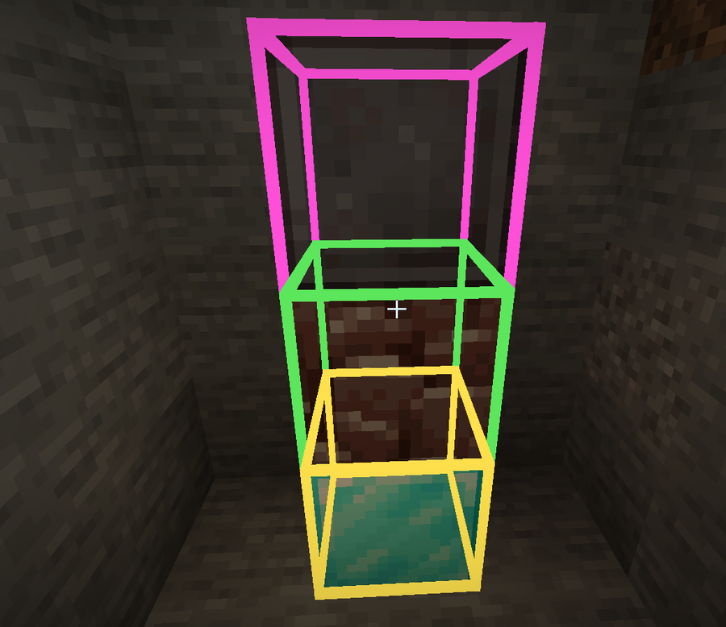
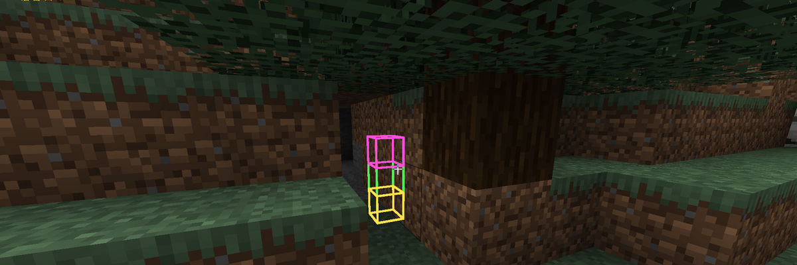
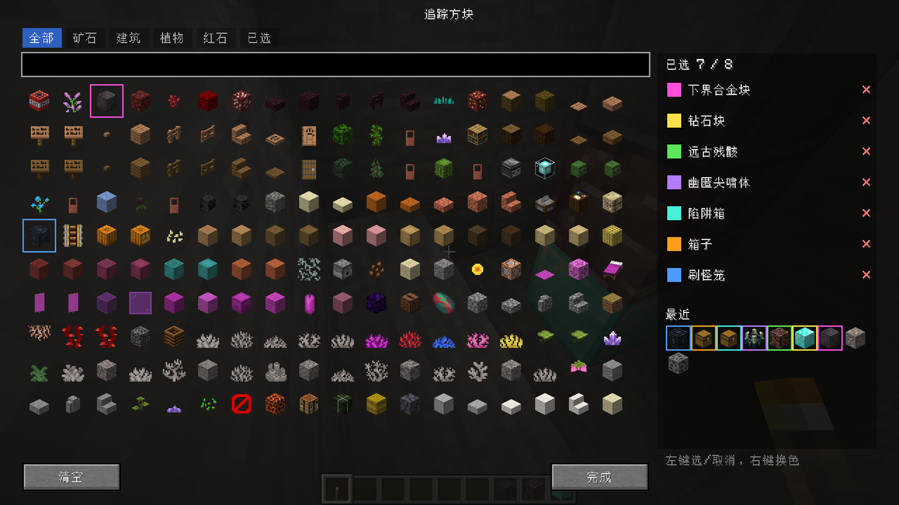

# Detective Eye


_中文名：侦探之眼_

[English](#english) · [中文](#中文)

A **client-side** ore/block highlighter for **Minecraft 1.20.1 Forge**. Press a key, pick any blocks you care about, and their outlines show through terrain — no server-side installation required.



## Features



- **See through walls** — outlines are drawn with depth test disabled, so ores behind stone are visible.
- **Any block, not just ores** — chests, spawners, ancient debris, your base's beacons… pick up to 8 blocks, each with its own colour.
- **Pinyin search** — type `zuanshi`, `zsks`, `kuang` or `钻石` in the picker (Chinese names, pinyin, and initials all work).
- **Adjustable radius** — `[` and `]` shrink/grow the scan range (8–128 blocks) on the fly.
- **Cheap when idle** — nothing runs while the overlay is off; scanning happens once per second and is skipped entirely for chunks that don't contain a tracked block.
- **Pure client** — safe to join servers that don't have the mod; `displayTest="IGNORE_SERVER_VERSION"` keeps the server from kicking you.

## Default key bindings

| Key | Action |
|---|---|
| `H` | Toggle the overlay on/off |
| `[` / `]` | Decrease / increase scan range |
| `Numpad 3` | Open the block picker |

All of them can be rebound in **Options → Controls → Vein Outline**.

In the picker: **left click** selects/deselects a block (max 8), **right click** cycles its colour, there are tabs for ores / building / plants / redstone / selected, plus a list of recently used blocks.



## Installation

1. Install **Forge 47.x** for Minecraft **1.20.1**.
2. Download `detective-eye-<version>.jar` from the [Releases](../../releases) page.
3. Drop it into `.minecraft/mods/` (or your launcher's instance `mods` folder).
4. Launch the game. It's client-side only — no server setup needed.

Requires **Java 17**.

## Configuration

`config/orevision-client.toml` is generated on first launch:

```toml
[general]
    # Scan radius in blocks (8–128)
    maxDistance = 48.0
    # Maximum number of outlines rendered at once (8–4000)
    maxOres = 300
```

Your selected blocks live in `config/orevision-targets.json` — deleting it resets the picker.

## Building from source

```bash
git clone https://github.com/<you>/detective-eye.git
cd detective-eye
./gradlew build                      # output: build/libs/detective-eye-<version>.jar
./gradlew runClient                   # launches a dev client
```

Needs JDK 17. On first build Gradle downloads the Forge userdev artifacts (a few hundred MB).

> The wrapper is configured to fetch Gradle itself from the Tencent mirror, because `services.gradle.org` is unreliable in mainland China. If you're elsewhere, restore the official URL in `gradle/wrapper/gradle-wrapper.properties`:
> `distributionUrl=https\://services.gradle.org/distributions/gradle-8.1.1-bin.zip`

If you're on a network where `maven.minecraftforge.net` is slow or unreachable, add `-PcnMirrors` to use the BMCLAPI mirrors instead:

```bash
./gradlew build -PcnMirrors
```

## Known limitations

- Only blocks with an item form are listed in the picker, and only vanilla `minecraft:` namespaces — blocks added by other mods aren't shown yet.
- Outlines are axis-aligned boxes; there's no fancy glow or particle effect.

## License

[MIT](LICENSE) — do whatever you want with it, just keep the copyright notice.

---

# 中文

**Minecraft 1.20.1 Forge 纯客户端**的方块透视模组：按一个键，选你想看的方块，它们的轮廓会穿透地形显示出来，不需要在服务端装任何东西。


## 功能


- **穿墙显示** —— 关掉了深度测试，隔着石头也能看见后面的矿石。
- **不限于矿石** —— 箱子、刷怪笼、远古残骸、你家信标…… 最多同时选 8 种方块，每种一个颜色。
- **拼音搜索** —— 在界面里输 `zuanshi`、`zsks`、`kuang` 或「钻石」都能搜到。
- **范围可调** —— `[` 和 `]` 实时缩小/扩大扫描半径（8–128 格）。
- **闲着不耗性能** —— 关闭时不跑任何逻辑；开启时每秒扫一次，不含目标方块的区块直接跳过。
- **纯客户端** —— 进没装这个模组的服务器不会掉线（`displayTest="IGNORE_SERVER_VERSION"`）。

## 默认按键

| 按键 | 作用 |
|---|---|
| `H` | 开关透视 |
| `[` / `]` | 缩小 / 扩大扫描范围 |
| `小键盘 3` | 打开方块选择界面 |

都可以在 **选项 → 控制 → 矿脉轮廓** 里改。界面里：**左键**选中/取消（上限 8 个），**右键**换颜色，顶部有 矿石 / 建筑 / 植物 / 红石 / 已选 分类和「最近使用」。


## 安装

1. 给 Minecraft **1.20.1** 装 **Forge 47.x**。
2. 到 [Releases](../../releases) 下载 `detective-eye-<版本>.jar`。
3. 丢进 `.minecraft/mods/`（或启动器对应实例的 `mods` 文件夹）。
4. 启动游戏。纯客户端，不用改服务端。

需要 **Java 17**。

## 配置

首次启动后生成 `config/orevision-client.toml`：

```toml
[general]
    maxDistance = 48.0   # 扫描半径，单位格（8–128）
    maxOres = 300        # 同时显示的最大轮廓数（8–4000）
```

选中的方块存在 `config/orevision-targets.json`，删掉它就恢复默认。

## 从源码构建

```bash
git clone https://github.com/<you>/detective-eye.git
cd detective-eye
./gradlew build          # 产物在 build/libs/detective-eye-<版本>.jar
./gradlew runClient      # 启动开发客户端
```

需要 JDK 17。第一次构建会下载几百 MB 的 Forge 依赖。

> 仓库里的 wrapper 默认从腾讯镜像下载 Gradle 本体（`services.gradle.org` 在国内经常断流）。如果你在海外，把 `gradle/wrapper/gradle-wrapper.properties` 里的地址改回官方：
> `distributionUrl=https\://services.gradle.org/distributions/gradle-8.1.1-bin.zip`

如果 `maven.minecraftforge.net` 太慢或连不上，加 `-PcnMirrors` 改用 BMCLAPI 镜像：

```bash
./gradlew build -PcnMirrors
```

## 已知限制

- 选择列表里只有带物品形式的方块，且只收 `minecraft:` 命名空间的 —— 其他模组加的方块暂时不显示。
- 轮廓是轴对齐的方框，没有发光或粒子效果。

## 协议

[MIT](LICENSE) —— 随便用，保留版权声明就行。
